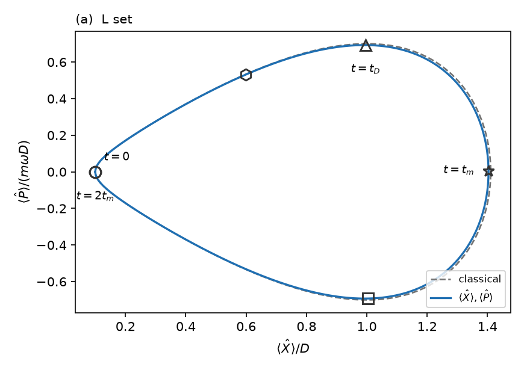
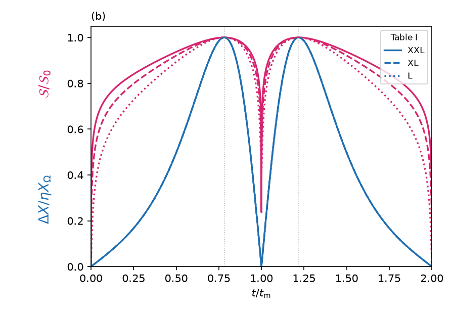
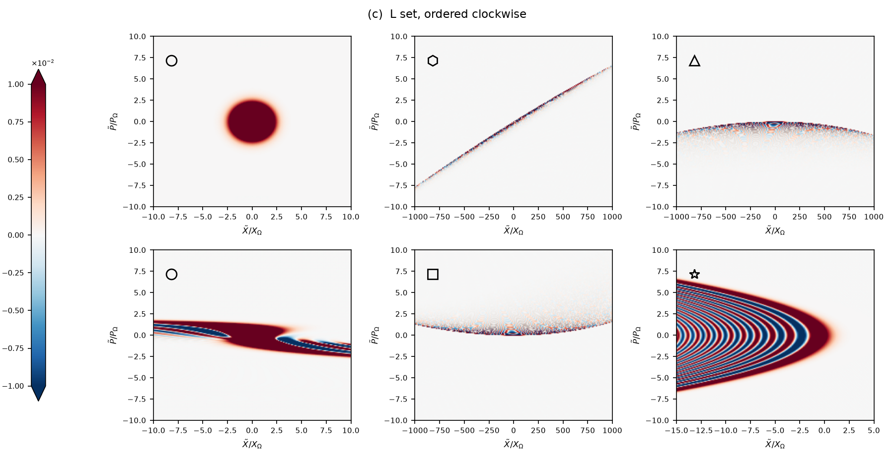
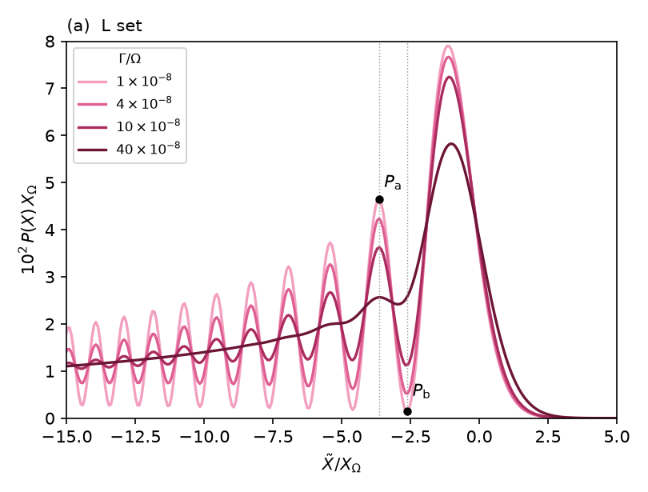
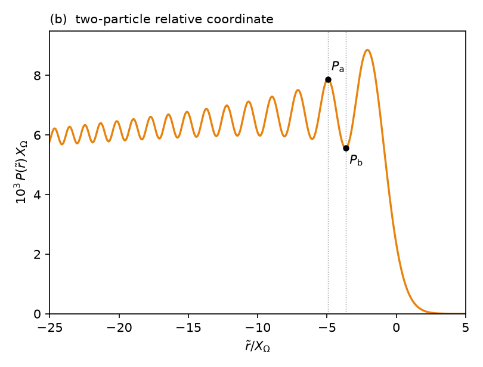
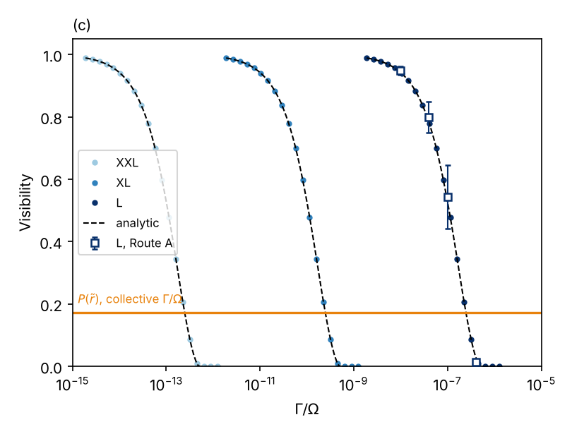
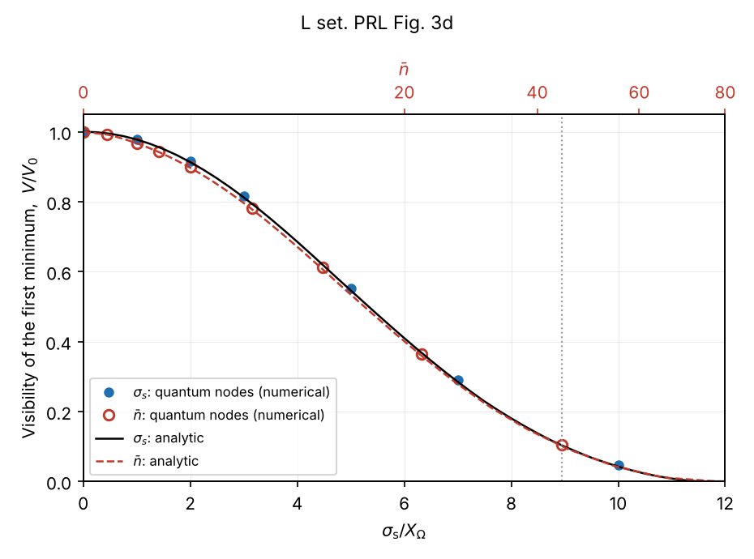
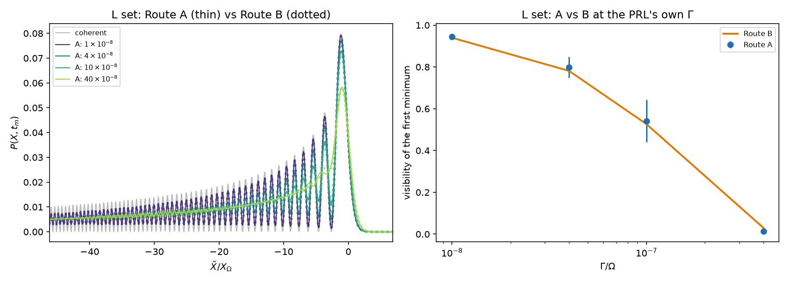
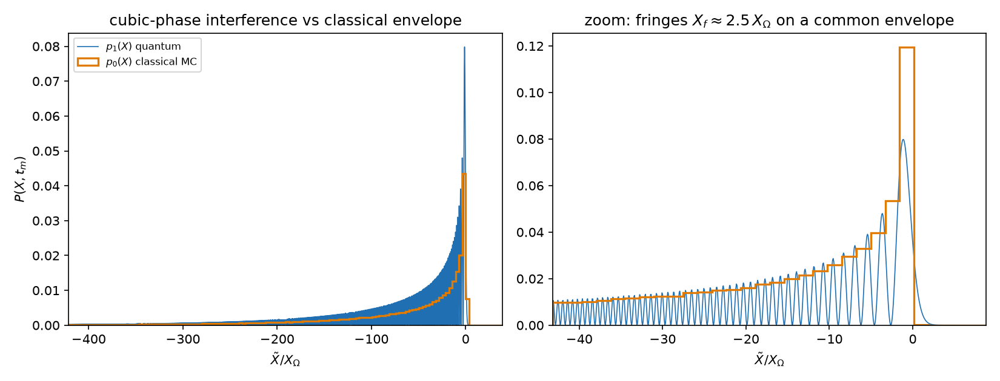

# doublewell — reproduction of PRL 132, 023601

Independent, from-scratch reproduction of
**M. Roda-Llordes, A. Riera-Campeny, D. Candoli, P. T. Grochowski, O. Romero-Isart,
"Macroscopic Quantum Superpositions via Dynamics in a Wide Double-Well Potential",
[Phys. Rev. Lett. 132, 023601 (2024)](https://doi.org/10.1103/PhysRevLett.132.023601)**
([arXiv:2303.07959](https://arxiv.org/abs/2303.07959)).

Figures 2 and 3 of the paper are reproduced for the L parameter set of its Table I
(`X_s/D = 0.1`, `ω/Ω = 1e-2`, `D/X_Ω = 1e4`, `n̄ = 0`), with the XL/XXL curves where the
paper shows them. A two-page summary with the paper's panels side by side with mine is in
[`notes/reproduction_note.pdf`](notes/reproduction_note.pdf).

## What is in the code

| piece | where | method |
|---|---|---|
| classical orbit, co-moving frame | `src/doublewell/classical.py` | `u'' = u − u³`, RK45; defines the frame for the quantum solver and the classical MC |
| quantum propagator | `src/doublewell/splitstep.py` | split-step Fourier for the residual state in the co-moving frame (L: `n = 2¹⁷`, half-width `4500 X_Ω`) |
| observables, squeezing | `src/doublewell/observables.py` | first/second moments; `S(t)` from the quadratic covariance dynamics (paper's endnote [41]) |
| Wigner function | `src/doublewell/wigner.py` | FFT of the autocorrelation of the residual state |
| analytical treatment | `src/doublewell/analytic.py` | constant-angle approximation of Riera-Campeny et al., [Quantum 8, 1393 (2024)](https://doi.org/10.22331/q-2024-07-02-1393) — the source of the *lines* in the PRL's Fig. 3(b–d): κ₃, κ₄, S(τ_m), φ → Airy Wigner function (Eq. 98) → marginal; decoherence as a blur with σ_b² = 4(Γ/ω)∫η²dτ (Eq. 39/45) |
| decoherence | `src/doublewell/decoherence.py` | Route A: stochastic momentum kicks, 256-trajectory ensemble. Route B: Gaussian blur with width from the Green's function of the linearised dynamics. Visibility `V = (P_a − P_b)/(P_a + P_b)` with tracked extrema (`visibility_prl`) |
| units and conventions | `src/doublewell/units.py`, `notes/conventions.md` | every factor of 2 in one place (`ħ_eff = 2` in zero-point units) |
| tests | `tests/` | Table I, Eq. (1), ground-state variance, master-equation coefficient, Route A vs B, resolution, analytic vs numerical t_m pattern |

## Figures: paper ↔ this work

Paper panels are not redistributed here; the DOI above opens them. The PDF note shows them side by side.
In Fig. 3(c,d) the markers are numerical and the dashed lines the analytical constant-angle result, as in the paper.

| paper | this work | notes |
|---|---|---|
| Fig. 2(a) |  | first moments over the classical orbit; loop closes at `2t_m`, far turning point at `⟨X⟩/D = √2` |
| Fig. 2(b) |  | `S/S₀` and `ΔX/ηX_Ω` for XXL/XL/L; `ΔX` peaks at `η X_Ω` at `t_D/t_m = 0.782` |
| Fig. 2(c) |  | Wigner function of the residual state at the six marked times, same axes as the paper |
| Fig. 3(a) |  | `P(X, t_m)` at `Γ/Ω = {1, 4, 10, 40}×10⁻⁸` |
| Fig. 3(b) |  | two-particle relative coordinate `P(r̃, t_m)`, self-convolution of the single-particle pattern (Supplemental Material) |
| Fig. 3(c) |  | visibility vs `Γ/Ω`: dots numerical, dashed analytic (computed directly for XXL/XL/L); squares = Route A with ensemble error; horizontal line = visibility of `P(r̃)` |
| Fig. 3(d) |  | visibility vs `σ_s` and `n̄` (top axis via `σ = √(2n̄)`): dots = full propagation of displaced states, lines = analytic |
| — |  | not in the paper: Route A (kicks) vs Route B (blur) at the paper's four `Γ` |
| — |  | not in the paper: quantum `P(X, t_m)` on top of the classical Monte-Carlo envelope |

## Numbers

"Paper" values marked † were read off the published figure by digitising its axes (±0.03 in `V`);
the rest are stated in the text or Table I. "This work" values come from the `.npz` files written by the scripts.

"Numerical" = split-step propagation (Route B blur unless marked A = stochastic kicks); "analytical" = this repo's implementation of the constant-angle treatment.

| quantity | paper | this work, numerical | this work, analytical |
|---|---|---|---|
| `√2 η`; `S₀` (XXL / XL / L) | `1e5, 1e4, 1e3`; 97, 77, 57 dB | 96.99, 76.99, 56.99 dB | — |
| orbit half-period `ω t_m` | `ln(4√2 D/X_s) = 4.036` | 4.047 (exact quadrature; +0.28 %) | — |
| `ΔX(t_D)/X_Ω` | `η = 707` | 707 | `η⋆ = 707.1` |
| fringe spacing `X_f/X_Ω` | ≈ 2.5 | 2.472 (2.506 on the finer grid) | 2.472 |
| coherent visibility `V₀` | 1 | 0.9976 | 0.9979 |
| Fig. 3c, L: `V/V₀` at `Γ/Ω = 4e-8, 1e-7, 4e-7` | 0.78, ≈0.53, 0.03 † | 0.783, 0.528, 0.030 (A: 0.80, 0.54, 0.01) | 0.783, 0.528, 0.029 |
| blur width `σ/X_Ω` at `Γ/Ω = 1, 4, 10, 40 ×1e-8` | — | B: 0.115, 0.230, 0.363, 0.727 (A/B = 1.00–1.16) | 0.115, 0.230, 0.363, 0.727 |
| Fig. 3b: peak of `10³ P(r̃) X_Ω` | ≈ 8.7 at `r̃ ≈ −2` † | 8.86 at `r̃ = −2.06` | 8.88 at −2.06 |
| Fig. 3c: visibility of `P(r̃)` | 0.172 † | 0.172 | 0.172 |
| Fig. 3d: `V/V₀` at `σ_s = 5, 7, 10 X_Ω` | 0.53, 0.27, 0.04 † | 0.550, 0.289, 0.046 | 0.546, 0.285, 0.042 |
| Fig. 3d: `V/V₀` at `n̄ = 40` | 0.10 † | 0.105 | 0.101 |
| timing error `σ_t = 1e-2 ω⁻¹` | "visible pattern" | `V/V₀ = 0.997` (0.81 at 10× that) | — |
| decoherence scales as `Γη²/ω` | stated | blur integral `∝ η²/(ω/Ω)` to 5 s.f. across L, XL, M | same |

## Limits and open points

* The lines in the paper's panels 3b–d are analytical (its Ref. [37]). Implementing that treatment lets me compare my numerics with my analytical curves: they agree to ≤ 0.005 in `V/V₀` in every panel of Fig. 3 (lines are drawn only in (c) and (d), where the paper has them; in (a) and (b) the two are indistinguishable), and the analytical blur width equals the exact linear-response (Route B) width to three figures at L. The only visible departure is the stochastic-kick ensemble at `Γ/Ω = 4×10⁻⁷` (0.014 vs 0.029, inside its ensemble error). The remaining ≲ 0.02 offsets against the published curves are at the level of reading the figure. The constant-angle blur *is* the Route-B Green's function with φ(τ′) frozen at φ(τ_d) — see `tests/test_analytic.py`.
* In Fig. 3c the numerical XL/XXL points are the L blur curve mapped through the Green's-function integral computed for each set, whereas the analytical XL/XXL lines are computed directly for those sets (`κ₃ = 1000.0` for all three, `X_f = 2.472`); in Fig. 2b all three sets come from the quadratic covariance dynamics. Only the L set was propagated as a full wavefunction.
* The position and momentum quadratures of the thermal mixture were propagated as separate node sets and composed multiplicatively. The momentum quadrature costs only ≈ 2 % (`V_mom = 0.978` at `n̄ = 40`).

## Running it

```bash
pip install -e .            # numpy, scipy, matplotlib; python >= 3.11
pytest                      # conventions, Table I, master-equation coefficient, A vs B

# Fig. 2 (L propagation to 2 t_m writes data/L_fig2ac.npz; then plotting)
python notebooks/run_fig2ac.py
python notebooks/fig2ac_L.py            # -> figures/stage1_fig2a_L.png, stage1_fig2c_L.png
python notebooks/fig2b.py               # -> figures/stage1_fig2b.png (covariance dynamics, no propagation)

# Fig. 3
python notebooks/run_stage3_L_routeA.py ensemble   # Route A at L, 256 trajectories (~1 h)
python notebooks/run_stage3_L_routeA.py figure     # -> stage3_AvsB_L.png
python notebooks/fig3abc_L.py           # -> stage3_fig3a_L.png, stage3_fig3b_L.png, stage3_fig3c_L.png
python notebooks/fig3d_L.py batch-sigma && python notebooks/fig3d_L.py figure-sigma   # ~1 h
python notebooks/fig3d_L.py batch-nbar  && python notebooks/fig3d_L.py figure-nbar    # ~1.5 h
python notebooks/make_fig3d.py          # -> stage3_fig3d_L.png
python notebooks/fig3_analytic.py       # -> stage3_fig3c_L_analytic.png, stage3_fig3d_L_analytic.png (~12 min; --reuse after the first run)
python notebooks/make_stage2.py         # -> stage2_L.png (quantum vs classical MC)

python notebooks/run_convergence.py [dtau|box|all]   # step halving / box doubling at t_m
```

`data/` is not tracked (large `.npz`); the scripts regenerate it.

## Layout

```
src/doublewell/   solver, observables, decoherence, analytic (constant-angle approximation), units
notebooks/        run_*.py propagate and write data/, fig*.py plot figures/
figures/          the panels above
notes/            conventions.md, discrepancy_log.md, reproduction_note.pdf
tests/            pytest
```
